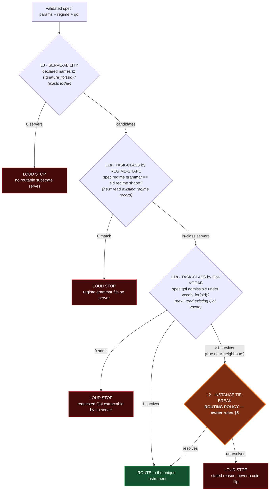

# Memo — Step 41: within-family hierarchical routing (DESIGN, for owner ruling)

**Status:** DESIGN shown for ruling. No code built. D.1b of the BIO WAVE packet.
**Author:** build chat, 2026-07-18. Era of record `a07f939` / HEAD `2612179`.
**Rule this memo enforces on itself:** *do not invent a tie-break silently.* The
structural narrowing (Levels 0–1) is buildable without a policy call; the
genuine-tie step (Level 2) is a routing **policy** and is presented as options
for the owner to rule. Nothing here is wired yet.

---

## 1. The problem

`select_substrate` (`tools/substrate_selection.py:159-203`) picks the one
substrate a spec routes to. Its rule today:

1. **Serve-ability** — a routable substrate can serve the spec iff every
   declared parameter **name** is in that substrate's parameter signature
   (`_SIGNATURES`).
2. **Mature-preferred** — among servers, keep the `mature` ones if any.
3. **R-B-1 loud stop** — if **more than one** candidate survives, STOP loudly
   naming all of them. The enrollment-order pick is retired; maturity is the
   *only* tie-breaker; **no further tie policy exists or may be invented.**

That is correct and safe for the five substrates routable today, because their
signatures are pairwise disjoint **except** the one ruled cantilever overlap.
But it makes near-neighbours **unroutable by default**: any spec two substrates
can both serve stops loudly.

**At bio scale this is most of the wave.** Whole families share a signature:
every structure predictor takes `{protein_sequence}`; every guide-scorer takes
`{guide_sequence, genome}`; etc. Under today's rule, the *second* member of every
family makes its family's specs unroutable. Step 41 must let a family spec
**resolve to ONE instrument, or stop loudly with a stated reason — never a coin
flip** (acceptance test #3).

---

## 2. What we already have to route with (no new machinery invented)

Each routable substrate already wires **three** structural facts, all under the
same discipline — a fail-loud lookup keyed by the *structurally selected*
substrate id (never parsed from a payload name, R-28H-1), each drawn from a
single wrapper source, never a third copy:

| Fact | Lookup | Single source | Shape today |
|---|---|---|---|
| **Parameter signature** | `signature_for(id)` (`substrate_selection.py`) | the wrapper's own required-field constants | a set of names |
| **Regime semantics** | regime record via `qoi_vocab` (R-23.5-5) | derived from the wrapper's typed input | one of `reynolds_band` / `analysis_type` / `operation_set` / `static_small_deflection` |
| **QoI vocabulary** | `vocab_for(id)` (`qoi_vocab.py`) | the wrapper's own QoI constants | shape-tagged: `field_reduction` / `named_quantity` / `symbolic_result` / `fixed_summary` |

Two of these are **not consulted at selection today** — the selection docstring
says so explicitly: *"The QoI request is deliberately NOT part of serve-ability
today."* Regime is validated in stage 2 but not used to route. **Step 41's
structural half is simply: bring regime-shape and QoI-vocab into the routing
decision.** The `alien_keys` mechanism already present on each regime record
even rejects a wrong-shape regime block *by name* — regime-shape is already a
working class discriminator; we are only asking selection to read it.

The prototype for this style of matching already ships:
`experiment_picker.spec_family` classifies a spec into a family by the **joint
presence of characteristic parameter names** (`{lid_velocity, cavity_length}`
→ `lid_driven_cavity`). Step 41 generalises that idea from parameter names to
the regime-shape + QoI-shape pair.

---

## 3. The proposed pipeline — task-class first, then instance

- **L0** is today's serve-ability, unchanged.
- **L1a + L1b are the "task-class first" step.** They are *not* new policy — they
  are deterministic **compatibility** checks against facts each substrate already
  declares. A structure-lookup substrate whose QoI vocab yields `mean pLDDT`
  cannot admit a `docking_score` QoI; a `reynolds_band` regime block cannot match
  an `analysis_type` substrate. These narrow a shared-signature family down to the
  genuine class, structurally, with no coin flip and no ruling required.
- **L2 is "then instance".** It only fires when ≥2 substrates survive L0+L1 — i.e.
  they serve the same params, share the regime shape, **and** admit the same QoI.
  Those are **true near-neighbours**. Picking among them is a policy — §5.

**R-B-1 is preserved, not replaced:** its loud stop becomes the L2 default. Step 41
just interposes structural narrowing *before* the stop, so the stop fires only on
genuine ties, not on every family.

---

## 4. Worked examples

### 4a. The cantilever family — a real, in-repo near-neighbour (no bio needed)

`calculix_cantilever_fea` and `fenicsx_cantilever_elastic` are both routable now.
Measured from disk today:

- Signatures: calculix's **7** params ⊂ fenicsx's **8** (`element_degree` is the
  one extra name).
- Regime shape: **both** `static_small_deflection`.
- QoI vocab shape: **both** `fixed_summary`, with **identical** fields
  `(tip_displacement, max_von_mises)`.

| Spec declares | L0 | L1a regime | L1b QoI | Outcome |
|---|---|---|---|---|
| `element_degree` + shared 7 | only fenicsx serves | — | — | **routes to fenicsx** (resolved at L0) |
| a QoI only one supports* | both serve | both match | one admits | **routes to that one** (resolved at L1b) |
| only the shared 7, shared QoI, static-deflection regime | both serve | both match | both admit | **true tie → L2 policy** |

\*today calculix and fenicsx expose the *same* QoI fields, so L1b does **not**
separate them — an honest limit: QoI discriminates *across* classes
(docking-score vs pLDDT) but not between two instruments computing the same
quantity. The cantilever pair is therefore the canonical L2 case, and it already
exists — it is exactly the "≥2 signature-overlapping substrates routable"
acceptance test #3 asks for.

### 4b. A bio `{protein_sequence}` family (illustrative — wired in D.2)

Say AlphaFold-DB (lookup, QoI `mean_pLDDT`) and Boltz-2 (filter, QoI
`RMSD`/`affinity`) are both routable and both take `{protein_sequence}`.

- Spec asks for `mean_pLDDT` → **L1b routes to AlphaFold-DB** (Boltz-2's vocab
  doesn't admit it). No tie.
- Spec asks for `affinity` → **L1b routes to Boltz-2**. No tie.
- Spec asks for a quantity **both** compute (e.g. a shared confidence scalar),
  same regime shape → **L2 policy**.

So most family specs resolve on the QoI they ask for. L2 fires only for genuinely
interchangeable instruments — and that is the decision below.

---

## 5. THE RULING — Level-2 tie-break among true near-neighbours

When ≥2 substrates survive L0+L1 (same params, same regime shape, same QoI), what
happens? **Pick one policy. This is the whole ruling D.1b needs.**

| # | Policy | How it resolves a true tie | Coin-flip risk | Cost |
|---|---|---|---|---|
| **1** | **Loud stop (extend R-B-1 to genuine ties).** | It doesn't — it STOPS with a stated reason; the spec author must add a discriminating param/QoI/regime, or the owner promotes exactly one candidate to `mature`. | **None** | Genuine near-neighbours always need upstream disambiguation. |
| **2** | **Structural deterministic cascade.** | Break the tie by ordered registry facts: `maturity` (mature>provisional>calibrating) → `cost_tier` (cheaper) → still-tied → loud stop. | **None** (deterministic, explainable) | Most bio substrates share `cost_tier="low"` and enter `calibrating`, so this usually *collapses to the loud stop anyway* — honest but a weak resolver early on. |
| **3** | **Owner-ruled per-family preference table.** | A recorded `_FAMILY_PREFERENCE` map (family → ordered instances), governance-gated like `_CONTRACTS`. Top routable+serving instance wins; family absent → loud stop. | **None** (explicit) | One owner ruling per family that needs a default winner. |
| **4** | **Push disambiguation to authoring.** | Require the regime/QoI to carry a class-discriminator so stage 2 authors "against exactly one instrument" (the line R-B-1 already prints). Selection then rarely meets a genuine tie. | **None** at selection; moves to stage 2 (validated in code). | Stage-2 prompt + schema change; correctness rests on the model authoring the discriminator. |

### Build-chat recommendation (owner rules)

- **Build L0 + L1a + L1b now** — structural narrowing, no policy call. This alone
  makes near-neighbour families routable via the QoI they ask for, and is what
  turns "most of bio is unroutable" into "most of bio routes on its QoI."
- **For L2, adopt Option 1 (loud stop, stated reason) as the default**, because it
  satisfies acceptance test #3 verbatim and never invents a pick — **with Option 3
  (per-family preference) as the explicit, owner-ruled upgrade** for any single
  family that genuinely needs a default winner (e.g. two interchangeable structure
  predictors where you'd rather route than stop).
- **Not recommended:** Option 2 as the *primary* resolver — it looks principled
  but collapses to the loud stop for same-cost/same-rung bio substrates, so it
  buys little over Option 1 while adding a cascade to reason about. It can ride
  *inside* Option 1/3 later as a first cut if evidence asks.

This combination: builds the structural half without a ruling, keeps R-B-1's
no-silent-pick spine, and asks the owner exactly one question — **L2 = Option 1
alone, or Option 1 + a per-family Option-3 table?**

---

## 6. What this touches (when built, after the ruling)

- `tools/substrate_selection.py` — insert L1a/L1b between serve-ability and the
  mature filter; L2 per the ruling. Reads `qoi_vocab` regime records + vocabs;
  no new source of truth.
- The R-B-1 raise text generalises to name the *stage* at which the stop fired
  (L0/L1a/L1b/L2) and why — still one loud stop, richer reason.
- Tests ADDED: the cantilever pair as the live L2 fixture (shared-7 spec →
  stop-or-preference per ruling; `element_degree` spec → fenicsx; QoI-split spec
  → the admitting one). Never totals.
- No era move: selection is not a model-visible surface; cavity is untouched.

---

## 7. Open honesty

- **QoI discriminates across classes, not between identical-output twins.** The
  cantilever pair proves it: same QoI fields → L1b can't split them. That is why
  L2 must exist at all, and why the ruling matters.
- **L1b needs each bio substrate's QoI vocab wired first (D.2).** Until a family's
  members are wired, their specs stop at L0/L1 as today — no regression, just not
  yet resolved. Step 41's code can land before D.2 and simply have nothing to
  narrow until the wrappers arrive.
- **This is routing policy, not a bug fix.** Per the packet's #1 risk, it is shown
  here for a ruling, not silently chosen.
